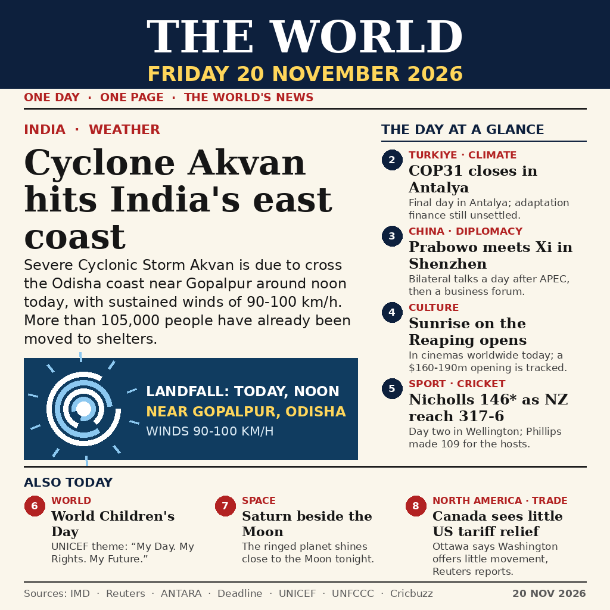

# The World — Friday 20 November 2026

[make.fun · news-image-20261120](https://make.fun/c/news-image-20261120)

A one-page newspaper front page summing up the world news of
**Friday 20 November 2026** in a single image.



## What the image shows

The front page of "THE WORLD", dated Friday 20 November 2026, with
eight verified stories from the day:

1. **Cyclone Akvan hits India's east coast** — Severe Cyclonic Storm
   Akvan due to cross the Odisha coast near Gopalpur around noon, with
   winds of 90–100 km/h; more than 105,000 people moved to shelters.
   (India Meteorological Department)
2. **COP31 closes in Antalya** — final day of the UN climate talks;
   adaptation finance still unsettled as the draft drops its $120bn
   target. (UNFCCC / press reporting)
3. **Prabowo meets Xi in Shenzhen** — Indonesia's president holds
   bilateral talks with China's leader a day after APEC, then joins a
   business forum. (ANTARA)
4. **Sunrise on the Reaping opens** — the new Hunger Games film reaches
   cinemas worldwide today, tracking a $160–190m opening weekend.
   (Deadline)
5. **Nicholls 146\* as NZ reach 317-6** — day two of the first Test in
   Wellington; Glenn Phillips made 109. (Cricbuzz)
6. **World Children's Day** — UNICEF marks the day under the theme
   "My Day. My Rights. My Future."
7. **Saturn beside the Moon** — the ringed planet shines close to the
   Moon in tonight's sky.
8. **Canada sees little US tariff relief** — Ottawa says Washington has
   offered little movement on easing tariffs. (Reuters)

Every story was checked against reporting dated to 20 November 2026;
stories that were first reported on 19 November (the Shenzhen
trilateral summit, the US Senate Iran vote, Voyager 1's light-day
confirmation) were deliberately left out. See NOTES.md for the
research, the variant comparison, and the sources.

## How to run

```sh
python3 main.py
```

This writes the image to `$MAKEFUN_OUTPUT_DIR/entry.png`
(default `/output/entry.png`). The program is standard library only,
needs no network, and writes the same bytes on every run — the image
is embedded in `main.py` as base64.

## Files

- `main.py` — the entry program (stdlib only, embeds the image)
- `entry.png` — the winning image, 1024×1024 PNG
- `build.py` — the script that drew all three variants with PIL
- `variant-v1.png`, `variant-v2.png`, `variant-v3.png` — the three
  variants built and compared (v1 won)
- `NOTES.md` — research, sources, and why v1 was chosen
- `LICENSE` — MIT

## License

MIT — see [LICENSE](LICENSE). Copyright (c) 2026 Donovan Entiman.
